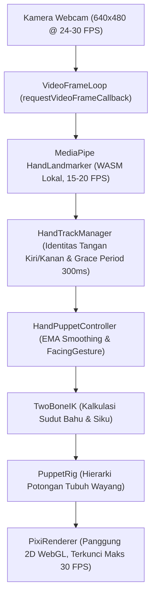
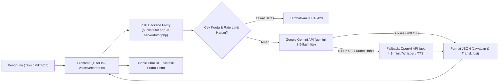

# Wayang Bali Interactive

> **Panggung Wayang Digital Interaktif Berbasis AI, Computer Vision, dan WebAssembly**  
> Menghidupkan seni tradisi Wayang Kulit Bali melalui gerak tangan secara langsung di depan kamera peramban tanpa memerlukan sensor tambahan.

---

## 1. Description
**Wayang Bali Interactive** adalah aplikasi web interaktif yang memungkinkan siapa saja merasakan pengalaman menjadi seorang *Dalang* wayang kulit Bali digital secara langsung melalui peramban web (*browser*). Dengan memanfaatkan teknologi *Computer Vision* berbasis kecerdasan buatan (**Google MediaPipe Hand Landmarker via WebAssembly**), gerakan tangan fisik pengguna dipindai secara lokal melalui kamera web (laptop maupun smartphone), lalu diterjemahkan menjadi artikulasi gerak tokoh wayang kulit di atas panggung grafis 2D (**PixiJS v8**).

Gerakan jari telunjuk dan jari tengah menggerakkan lengan wayang secara dinamis dengan algoritma *Two-Bone Inverse Kinematics* (IK), sementara posisi dan sudut telapak tangan mengendalikan badan wayang. Selain panggung permainan, aplikasi ini terintegrasi dengan **AI Tutor Wayang Bali** multimodal (teks dan rekaman suara) yang ditenagai oleh **Google Gemini** dan failover otomatis ke **OpenAI**, siap mengedukasi masyarakat mengenai filosofi, sejarah, dan nilai-nilai tradisi pewayangan Bali.

---

## 2. Problem
- **Kesenjangan Generasi terhadap Seni Tradisi**: Seni pertunjukan wayang kulit Bali yang sarat akan nilai filosofis dan kearifan lokal makin berjarak dengan generasi muda. Media pengenalan budaya yang ada saat ini umumnya bersifat statis dan pasif (buku teks atau video dokumenter satu arah).
- **Hambatan Aksesibilitas Perangkat Keras**: Pengalaman interaktif berbasis pelacakan gerak (*motion tracking*) di pameran budaya biasanya membutuhkan sensor perangkat keras yang mahal (seperti Microsoft Kinect atau Leap Motion) dan instalasi aplikasi native yang rumit.
- **Kekhawatiran Privasi & Efisiensi Komputasi**: Banyak aplikasi kamera modern mengunggah rekaman video ke peladen awan (*cloud*), menimbulkan keraguan privasi pengguna dan pemborosan bandwidth serta panas berlebih pada perangkat seluler.

---

## 3. Target User
**Masyarakat Umum**, yang mencakup:
1. **Pelajar & Generasi Muda**: Menggali dan mempelajari kebudayaan tradisional wayang Bali melalui media digital interaktif yang seru, modern, dan mudah diakses.
2. **Pengunjung Pameran Budaya**: Menikmati pengalaman kilat menjadi dalang digital di pameran seni, museum, atau instalasi publik tanpa repot mengunduh aplikasi.
3. **Pendidik, Guru, & Penggiat Seni**: Sarana peraga edukasi budaya interaktif di kelas atau lokakarya seni yang dilengkapi asisten tanya jawab cerdas (*AI Tutor*).
4. **Wisatawan Domestik & Mancanegara**: Mengenal tokoh, karakter, dan filosofi wayang kulit Bali secara intuitif langsung dari gawai pintar.

---

## 4. Key Features
- **Kontrol Dua Tangan Independen (*Dual-Hand Control*)**: Tangan kiri fisik mengendalikan tokoh di slot kiri panggung, sedangkan tangan kanan mengendalikan slot kanan panggung (dapat memainkan 1 tokoh saja atau 2 tokoh sekaligus bersama teman).
- **Artikulasi Lengan Dinamis (*Two-Bone Inverse Kinematics*)**: Gerakan jari telunjuk mengendalikan lengan utama dan jari tengah mengendalikan lengan sekunder dengan batasan sendi bahu dan siku anatomis yang lentur dan realistis.
- **Pelacakan Posisi & Sudut Badan (*Palm Tracking & Body Tilt*)**: Posisi telapak tangan menggerakkan translasi badan wayang, dan sudut kemiringan tangan membuat wayang condong secara proporsional.
- **Gestur Balik Arah Hadap (*Facing Flip Gesture*)**: Gestur alami tangan (mengepal sekitar 0,5 detik lalu meluruskan 4 jari) untuk membalikkan orientasi hadap wayang di panggung dengan jeda pengaman (*cooldown*).
- **Identitas Tangan Persisten (*Hand Identity Persistence*)**: Wayang tidak akan tertukar meskipun kedua tangan saling bersilangan (*hand crossing*) atau terhalang sesaat (*grace period* 300 ms).
- **AI Tutor Wayang Bali Multimodal (Teks & Suara)**: Fitur tanya jawab interaktif seputar sejarah, karakter, dan tradisi wayang Bali melalui input teks maupun rekaman suara langsung dari mikrofon browser.
- **Dua Penyedia AI (*Gemini Primary + OpenAI Automatic Fallback*)**: Menggunakan Google Gemini sebagai mesin utama dan secara otomatis dialihkan ke OpenAI saat kuota/rate limit (HTTP 429) tercapai.
- **Sintesis Suara & Audio Budaya**: Jawaban tutor dapat didengarkan secara lisan melalui suara AI/sintesis suara perangkat (*Text-to-Speech*), diiringi alunan musik gamelan Bali autentik (*backsound*).
- **100% Pemrosesan Kamera Lokal & Privasi Terjaga**: Seluruh komputasi visi komputer dijalankan *on-device* di browser pengguna via WebAssembly. Tidak ada satu pun frame video webcam yang dikirim ke server.
- **Performa Ringan, Adem & Ramah Baterai**: Frame rate terkunci stabil pada maksimal 30 FPS dengan sistem inferensi adaptif dan penjedaan otomatis saat tab diminimalkan (*Page Visibility API*).
- **Dukungan Cache Offline (PWA) & Antrean Unduhan**: Aset panggung disimpan ke cache peramban via *Service Worker*, serta antrean unduhan aman (*download queue*) agar server tidak kelebihan beban saat traffic ramai.

---

## 5. Tech Stack
- **Frontend**:
  - **Bahasa**: TypeScript 7 (Strict Mode)
  - **Engine Grafis 2D**: PixiJS v8 (WebGL Renderer)
  - **Computer Vision**: Google MediaPipe Tasks Vision (`@mediapipe/tasks-vision` v1.0.1 - WebAssembly / WASM)
  - **Styling & UI**: Semantic HTML5 + Modern Vanilla CSS3 (Glassmorphism & Responsive Flex/Grid)
  - **Bundler & Tooling**: Vite 8
  - **Tipografi**: `@fontsource/cormorant-garamond` & `@fontsource/plus-jakarta-sans` (Self-hosted offline fonts)
  - **Browser APIs**: `requestVideoFrameCallback()`, MediaRecorder API, Web Speech API (SpeechSynthesis), Service Worker API
- **Backend**:
  - **Bahasa / Runtime**: PHP >= 8.1
  - **Ekstensi PHP**: `ext-curl`, `ext-mbstring`
  - **Fungsi Backend**: Proxy aman pemanggilan API AI (Gemini & OpenAI), validasi kontainer audio (MP4, WebM, OGG), pembatasan kuota (*rate limiting*), dan antrean unduhan aset (`queue.php`).
- **Database**:
  - **Stateless / No Database**: Aplikasi tidak memerlukan database relasional (SQL) maupun NoSQL.
  - Data katalog dan konfigurasi tokoh didefinisikan secara *data-driven* melalui file TypeScript (`src/puppet/characters/catalog.ts`).
  - Pembatasan kuota harian AI Tutor disimpan secara atomik melalui file lock cache (`wayangbali-tutor-budget.json` via PHP `flock`).
- **Hosting**:
  - **Web Server**: Apache Web Server (dengan modul `mod_rewrite`, `.htaccess`, dan runtime PHP 8.1+)
  - **Domain**: `wayangbali.hikari.my.id`

---

## 6. AI Implementation
- **Model/API**:
  - **Google Gemini API**: Model `gemini-3.5-flash-lite` (Penyedia AI utama untuk penalaran teks dan input rekaman audio).
  - **OpenAI API (Fallback Otomatis)**: Model `gpt-4.1-mini` (Teks jawaban), `gpt-transcribe` / `whisper-1` (Transkripsi rekaman audio suara pengguna), dan `gpt-4o-mini-tts` (Sintesis audio ucapan MP3) jika Gemini mengalami HTTP 429 atau kuota habis.
  - **Google MediaPipe Hand Landmarker (`hand_landmarker.task`)**: Model Computer Vision on-device (WASM).
- **AI Function**:
  - **Pelacakan Sendi Tangan (*Pose Estimation*)**: Memindai dan melacak 21 titik sendi 3D tangan secara *real-time* untuk menggerakkan rig boneka wayang.
  - **Cultural Knowledge Tutor**: Berperan sebagai pemandu budaya yang menjawab pertanyaan pengguna seputar filosofi, tokoh, kisah pewayangan, dalang, dan tradisi Wayang Bali secara ringkas (maks. 2 kalimat / ~55 kata) dengan sistem pengaman penolakan topik di luar Wayang Bali.
  - **Transkripsi Suara (*Speech-to-Text*)**: Mengonversi ucapan pertanyaan lisan pengguna dari mikrofon menjadi teks pertanyaan pada ruang obrolan (*chat*).
  - **Sintesis Ucapan (*Text-to-Speech*)**: Membacakan jawaban edukasi secara lisan kepada pengguna.
- **Input**:
  - **Computer Vision**: Frame video kamera webcam lokal pengguna (resolusi optimal 640×480 @ 24–30 FPS).
  - **AI Tutor**: Teks pertanyaan pengguna (panjang 1–300 karakter) **atau** rekaman audio suara mikrofon pengguna (format MP4, WebM, atau OGG; durasi maksimal 15 detik; ukuran payload ≤ 256 KiB).
- **Output**:
  - **Computer Vision**: Koordinat 21 landmark sendi tangan ternormalisasi (X, Y, Z), deteksi tangan kiri/kanan (*handedness*), dan tingkat keyakinan (*confidence score*).
  - **AI Tutor**: Respon teks jawaban edukasi Wayang Bali (JSON payload), transkripsi teks pertanyaan pengguna (jika input suara), dan suara lisan jawaban (Web Speech API audio atau stream MP3).

---

## 7. Architecture

### 7.1 Diagram Pipeline Gameplay (Computer Vision & Panggung 2D)


### 7.2 Diagram Pipeline AI Tutor (Dual-Provider Fallback)


---

## 8. Installation / Local Run

### Prasyarat Sistem
- **Node.js 22.6 atau lebih baru** (NPM terpasang).
- **PHP 8.1 atau lebih baru** dengan ekstensi `curl` dan `mbstring` aktif (hanya diperlukan untuk menjalankan AI Tutor).
- Peramban web modern yang mendukung WebGL dan WebAssembly (Google Chrome, Microsoft Edge, Mozilla Firefox, atau Safari terbaru).
- Kamera web (webcam) yang berfungsi baik.

---

### Langkah Instalasi & Menjalankan

1. **Klon Repositori & Masuk ke Direktori Proyek**:
   ```bash
   git clone https://github.com/username/wayangbali.git
   cd wayangbali
   ```

2. **Pasang Dependensi**:
   ```bash
   npm install
   ```

3. **Konfigurasi Environment Variables**:
   Salin berkas contoh `.env.example` menjadi `.env`:
   ```bash
   # Di Linux / macOS:
   cp .env.example .env

   # Di Windows (PowerShell):
   Copy-Item .env.example .env
   ```
   Buka file `.env` dan masukkan API Key Anda (lihat bagian [9. Environment Variables](#9-environment-variables)).

4. **Jalankan Aplikasi**:
   
   - **Opsi Rekomendasi — Satu Perintah (Game + AI Tutor)**:
     ```bash
     npm run serve-all
     ```
     Buka peramban di `http://localhost:5173`. Perintah ini menjalankan server Vite (dengan hot-reload) dan server lokal PHP di port `8124` secara bersamaan. Panggilan `/tutor.php` otomatis diteruskan ke PHP backend.

   - **Opsi Khusus Permainan Saja (Tanpa AI Tutor)**:
     ```bash
     npm run dev
     ```
     Buka `http://localhost:5173`. Mode ini hanya menyalakan frontend Vite. Panggung permainan wayang dapat dimainkan penuh, tetapi AI Tutor tidak aktif.

   - **Opsi Uji Build Produksi Penuh**:
     ```bash
     npm run build
     php -S 127.0.0.1:8123 -t dist
     ```
     Buka `http://127.0.0.1:8123`.

---

### Perintah Pengujian & Pengecekan Kode
| Perintah | Deskripsi |
|---|---|
| `npm run typecheck` | Menjalankan validasi tipe TypeScript (`tsc --noEmit`). |
| `npm run test:gesture` | Menjalankan unit test logika gestur balik hadap wayang. |
| `php -l server/tutor.php` | Melakukan linter sintaks berkas backend PHP AI Tutor. |
| `npm run build` | Melakukan typecheck, build aset produksi ke folder `dist/`, dan membuat manifest cache offline. |

---

## 9. Environment Variables
Konfigurasi rahasia dan parameter server disimpan dalam file `.env` di direktori utama (*root*) proyek. **Gunakan berkas `.env.example` sebagai acuan dan jangan pernah melakukan commit file `.env` asli ke repositori publik.**

```dotenv
# Server-only. Never prefix this key with VITE_.
GEMINI_API_KEY=your_gemini_api_key_here
GEMINI_MODEL=gemini-3.5-flash-lite
GEMINI_MAX_OUTPUT_TOKENS=180
TUTOR_DAILY_LIMIT=300

OPENAI_API_KEY=your_openai_api_key_here
OPENAI_MODEL=gpt-4.1-mini
OPENAI_MAX_OUTPUT_TOKENS=180
OPENAI_TRANSCRIBE_MODEL=gpt-transcribe
OPENAI_TTS_MODEL=gpt-4o-mini-tts
OPENAI_TTS_VOICE=coral
```

### Rincian Variabel:
| Variabel | Deskripsi | Default |
|---|---|---|
| `GEMINI_API_KEY` | Kunci API Google Gemini untuk layanan AI Tutor utama. | *(Wajib diisi untuk Gemini)* |
| `GEMINI_MODEL` | Model Google Gemini yang digunakan. | `gemini-3.5-flash-lite` |
| `GEMINI_MAX_OUTPUT_TOKENS` | Batas maksimum token respon dari Gemini. | `180` (maks keras: 240) |
| `TUTOR_DAILY_LIMIT` | Batas maksimal total pertanyaan tutor per hari untuk seluruh situs. | `300` |
| `OPENAI_API_KEY` | Kunci API OpenAI untuk cadangan otomatis (*fallback*). | *(Opsional/Cadangan)* |
| `OPENAI_MODEL` | Model obrolan OpenAI saat fallback. | `gpt-4.1-mini` |
| `OPENAI_MAX_OUTPUT_TOKENS` | Batas maksimum token respon dari OpenAI. | `180` |
| `OPENAI_TRANSCRIBE_MODEL` | Model transkripsi suara OpenAI. | `gpt-transcribe` (`whisper-1`) |
| `OPENAI_TTS_MODEL` | Model *Text-to-Speech* OpenAI untuk menghasilkan suara MP3. | `gpt-4o-mini-tts` |
| `OPENAI_TTS_VOICE` | Karakter suara OpenAI untuk pembacaan jawaban. | `coral` |

> [!CAUTION]
> **Keamanan Kunci API:** Seluruh API Key di atas hanya dibaca oleh backend PHP di lingkungan server. **Jangan pernah memberi awalan `VITE_`** pada variabel rahasia ini agar tidak ikut terkompilasi ke dalam bundle JavaScript publik frontend.

---

## 10. Deployment
Aplikasi telah dipublikasikan dan dapat diakses secara langsung melalui tautan resmi:

🌐 **URL Produksi**: [wayangbali.hikari.my.id](https://wayangbali.hikari.my.id)

### Panduan Deployment Server (Apache + PHP):
1. Jalankan `npm run build` untuk menghasilkan bundel siap rilis di direktori `dist/`.
2. Unggah direktori `dist/` sebagai *Document Root* (atau letakkan seluruh isinya ke folder `public_html`).
3. Unggah direktori `server/` dan berkas `.env` sejajar dengan folder publik (di luar akses publik web langsung).
4. Pastikan Apache mengaktifkan modul `mod_rewrite` dan mengeksekusi PHP versi 8.1+ dengan ekstensi `curl` dan `mbstring`.
5. Berkas `.htaccess` bawaan secara otomatis mencegah pengunduhan langsung file `.env*` dan mengarahkan endpoint API `/tutor.php` serta `/queue.php`.

---

## 11. Known Limitations
Sebagai produk *Minimum Viable Product* (MVP), sistem memiliki batasan operasional sebagai berikut:
1. **Katalog Karakter Terbatas**: Database tokoh saat ini baru menyediakan **4 karakter punokawan Wayang Bali** ( Twalen, Merdah, Sangut, dan Delem).
2. **Tanpa Panduan Alur Cerita (Non-story Guided)**: Belum tersedia skenario lakon bertutur, alur narasi drama pementasan, atau panduan babak cerita interaktif seperti halnya pada pertunjukan wayang kulit Bali panggung langsung (*live dalang show*).
3. **Kapasitas Pelacakan Gerak**: Sistem saat ini dibatasi untuk mendeteksi maksimal 2 tangan fisik secara bersamaan (satu tangan untuk slot kiri dan satu tangan untuk slot kanan).
4. **Konektivitas Internet AI Tutor**: Fitur AI Tutor mewajibkan koneksi internet aktif untuk menghubungi API server Gemini/OpenAI (tidak dapat digunakan secara offline, meski panggung permainan wayang mendukung cache offline).
5. **Durasi Sesi**: Durasi bermain di panggung dibatasi maksimal 3 menit per sesi (dengan fitur reset otomatis jika tangan tidak terdeteksi selama 25 detik) guna mengoptimalkan kestabilan memori browser dan mencegah panas perangkat pada penggunaan berulang.

---

## 12. Third-party Resources / Credits
Proyek ini terwujud berkat integrasi teknologi, pustaka, dan aset kreatif berikut:

- **Library & Frameworks**:
  - [PixiJS](https://pixijs.com/) (`pixi.js` v8) — Mesin rendering grafis WebGL 2D interaktif.
  - [Google MediaPipe](https://developers.google.com/mediapipe) (`@mediapipe/tasks-vision`) — Model Computer Vision Hand Landmarker via WebAssembly.
  - [Vite](https://vitejs.dev/) — Bundler dan alat pengembang frontend modern.
  - [TypeScript](https://www.typescriptlang.org/) — Fondasi kode bertipe ketat (*strict typing*).
- **AI Models & API Services**:
  - [Google Gemini API](https://ai.google.dev/) (`gemini-3.5-flash-lite`) — Layanan penalaran AI multimodal utama.
  - [OpenAI API](https://openai.com/) (`gpt-4.1-mini`, Whisper Speech-to-Text, Open-AI TTS) — Layanan AI cadangan otomatis (*failover*).
- **Tipografi & Desain Web**:
  - Pustaka font self-hosted `@fontsource/cormorant-garamond` dan `@fontsource/plus-jakarta-sans`.
- **Aset Seni & Audio**:
  - Aset Wayang : Ngurah Made Arya Asmara Jaya, M.Sn (Seniman Dalang Pewayangan Bali).
  - Musik Latar Tradisional Gamelan Bali GENDING GENDER WAYANG “PENGRUMRUM” dari **Astadi Jaya** (https://youtu.be/LvChlFqEYRo?si=q9kT6YSc33A6npoa).

---

## 13. Team Members
- **I Putu Ngurah Harry Santika** — *Developer*
- **I Putu Adi Surya Arthayasa** — *Designner*
